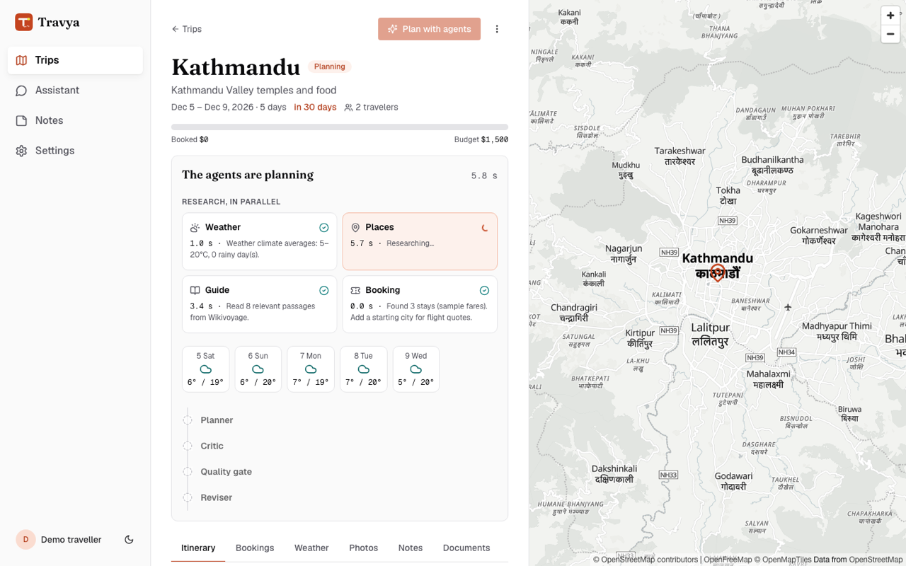
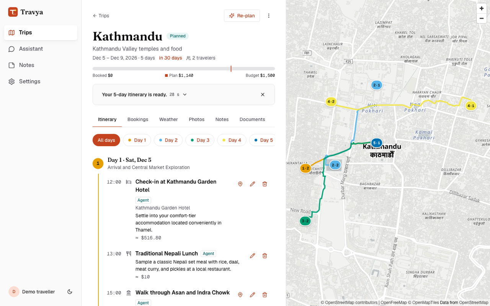
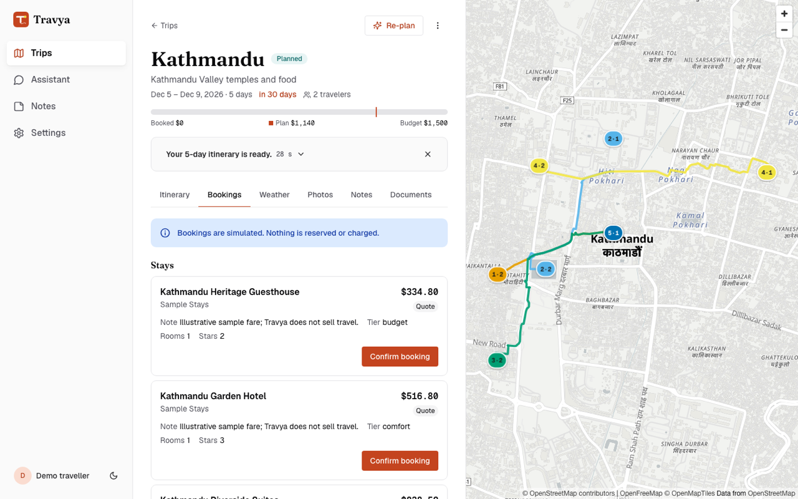
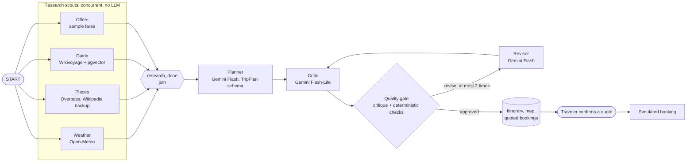
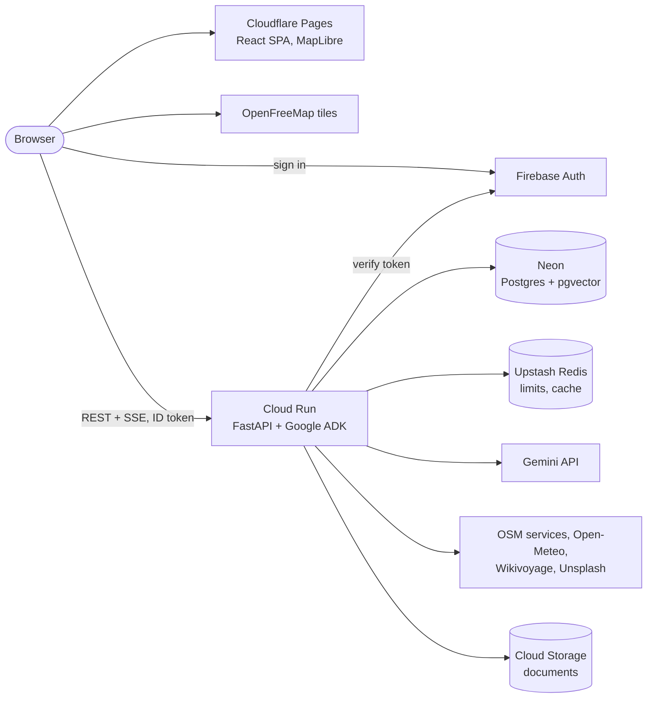

# Travya

**An agentic AI travel planner: parallel research agents, a planner and a critic loop in a Google ADK workflow graph on Gemini, grounded in open map data, with every step streamed live.**

[](https://github.com/fuseai-fellowship/Travya---Agentic-AI-Powered-Travel-Companion/actions/workflows/ci.yml)
[](https://github.com/fuseai-fellowship/Travya---Agentic-AI-Powered-Travel-Companion/actions/workflows/codeql.yml)
[](https://scorecard.dev/viewer/?uri=github.com/fuseai-fellowship/Travya---Agentic-AI-Powered-Travel-Companion)
[](LICENSE)
[](backend/pyproject.toml)
[](frontend/)

**Live demo:** <https://travya-app.pages.dev> (coming soon) · **Docs:** <https://travya-docs.pages.dev/>



<sub>Four research scouts run in parallel while places land on the map; then the planner, critic and quality gate take over. Live run on free tiers.</sub>

| Itinerary on the map | Simulated bookings, confirmed by you |
|---|---|
|  |  |

## What it does

- **Plans a day-by-day itinerary** for any destination, pace, budget and set of interests: four research agents work in parallel, a planner drafts, a critic and hard-coded checks review, a reviser fixes.
- **Shows the agents working.** Every step streams to the browser over Server-Sent Events; places and weather appear on the map while the plan is still being written. Live evals on six golden trips: 6/6 plans pass every hard check, 96% of named places land on the map, median 32 s on free tiers ([evals](docs/evals.md)).
- **Maps the trip** with numbered stops per day and walking or driving routes on OpenStreetMap data.
- **Answers travel questions** in a streaming assistant with five read-only tools (places, weather, travel guide, your trips, an itinerary) that cites its sources.
- **Quotes sample flights and stays.** A booking happens only when the traveler confirms it, and every booking is simulated.
- **Keeps the rest of the trip together**: notes, documents (PDF and images, signed downloads), photos with author credit, and per-day weather (forecast or climate estimate).

## How the agents work



The planner is an ADK 2.x `Workflow` graph: the scouts fan out from `START`, a join node waits for all four, and the quality gate routes to the reviser or to the end. The scouts are plain code and spend no tokens. Third-party text reaches the model only inside fenced, untrusted `<context>` blocks, output must match a Pydantic schema, and no agent can book: confirming is a separate API call made by the user. Details: [Agents](https://travya-docs.pages.dev/architecture/agents/).

## Architecture



## Tech stack

| Layer | Technology |
|---|---|
| Agents | Google ADK 2 `Workflow` graph (fan-out, join node, routed revisions), Gemini Flash with Flash-Lite fallback, Gemini embeddings |
| Backend | Python 3.13, FastAPI, Pydantic 2, SQLModel and SQLAlchemy 2 (async, psycopg 3), Alembic, sse-starlette, structlog |
| Data | Postgres 17 + pgvector (HNSW), Redis (`limits`, cashews) |
| Frontend | React 19, Vite, TypeScript, TanStack Router and Query, Chakra UI v3, MapLibre GL + OpenFreeMap |
| Auth | Firebase Authentication (email, Google, anonymous demo), firebase-admin |
| Open data | Nominatim, Photon, Overpass, Wikipedia, OSRM / OpenRouteService, Open-Meteo, Wikivoyage, Unsplash / Wikimedia Commons |
| Quality | pytest, respx, Ruff, mypy (strict), Vitest, Playwright, Biome |
| Delivery | Docker, Compose, GitHub Actions, Trivy + SBOM, CodeQL, OpenSSF Scorecard, Dependabot, release-please, Terraform |
| Hosting | Cloud Run, Neon, Upstash, Cloudflare Pages, Firebase, Cloud Storage: all free tier |

## Engineering highlights

- **IDOR-proof by construction.** Every query for user data goes through a repository bound to the caller (or to a trip already loaded through it); foreign and missing ids both return 404. A test walks every endpoint as a second user. [`repositories/base.py`](backend/app/repositories/base.py)
- **Abuse and cost controls.** Per-user moving-window rate limits and a global daily LLM budget in Redis; `429` with `Retry-After`, `503 Demo limit reached`. [`core/ratelimit.py`](backend/app/core/ratelimit.py)
- **Prompt-injection fencing.** OpenStreetMap, Wikivoyage and tool output enter prompts as fenced, untrusted data; the assistant's tools are read-only and scoped to the user. [`agents/planning/prompts.py`](backend/app/agents/planning/prompts.py)
- **Structured output plus deterministic checks.** Planner, critic and reviser emit Pydantic schemas; a quality gate adds code checks (every date covered, pace limits, budget within 10 %) before a plan is accepted. [`agents/planning/checks.py`](backend/app/agents/planning/checks.py)
- **Fast on free tiers.** Each scout has a 30 s budget, Overpass races a Wikipedia backup, every model call has a timeout, and an overloaded model hands over to Flash-Lite at once instead of retrying: the median live plan takes 32 s. [`agents/planning/pipeline.py`](backend/app/agents/planning/pipeline.py)
- **Ports and adapters with fakes.** Nine ports, real adapters with fallbacks, polite cached HTTP, and deterministic fakes: `OFFLINE_INTEGRATIONS=true` runs the whole flow with no keys or network, so tests and CI run offline. [`integrations/ports.py`](backend/app/integrations/ports.py)
- **One required CI check.** `ci-ok` aggregates path-filtered jobs: lint, types, tests, an OpenAPI drift check, migrations on an empty database, Playwright on the production images, a gitleaks secret scan, Trivy and SBOMs; CodeQL and Scorecard alongside. [`ci.yml`](.github/workflows/ci.yml)
- **Keyless deploys.** GitHub OIDC to Workload Identity Federation, limited to this repository's `main`; one image per commit runs the migration job, then serves; smoke test, then Cloudflare Pages. [`deploy.yml`](.github/workflows/deploy.yml)
- **$0 hosting.** Cloud Run scales from zero to one instance; Neon, Upstash, Cloudflare Pages and Firebase free tiers; Terraform with a $1 budget alert. [`infra/terraform`](infra/terraform)

## Run locally

Requires Docker with Compose v2.24+.

```sh
git clone https://github.com/fuseai-fellowship/Travya---Agentic-AI-Powered-Travel-Companion.git travya
cd travya
cp .env.example .env    # offline mode: no API keys needed
make up                 # Postgres + pgvector, Redis, Firebase Auth emulator, migrations, API, web
```

Open <http://localhost:5173> for the app and <http://localhost:8000/api/v1/docs> for the API. Postgres is published on host port **5433** (5432 is often taken by a local install).

`OFFLINE_INTEGRATIONS=true` (the default in `.env.example`) replaces every external service with a deterministic fake and the Gemini planner with a scripted one, so the full flow works without keys. For the real agents, set these in `.env` and run `make up` again:

```sh
GEMINI_API_KEY=<your Google AI Studio key>
OFFLINE_INTEGRATIONS=false
```

Tests and linters run on the host (needs [uv](https://docs.astral.sh/uv/) and Node 24): `make test`, `make lint`, `make e2e`. `make help` lists every target.

## Project structure

```text
.
├── backend/              FastAPI API (Python 3.13, uv)
│   ├── app/              api, agents, core, integrations, llm, models, repositories, schemas, services
│   ├── alembic/          database migrations
│   ├── tests/            api, integrations, unit
│   └── Dockerfile
├── frontend/             React SPA (Vite)
│   ├── src/
│   ├── Dockerfile
│   └── nginx.conf
├── infra/
│   ├── terraform/        Cloud Run, Artifact Registry, Secret Manager, WIF, Cloud Storage, budget
│   ├── firebase/         Auth emulator image
│   └── postgres/init/    pgvector and the test database
├── docs/                 documentation site (MkDocs Material)
├── .github/workflows/    ci, codeql, scorecard, deploy, release-please, docs
├── compose.yaml          production-like stack; compose.override.yaml adds dev mode
├── Makefile
└── mkdocs.yml
```

## Documentation

The [documentation site](https://travya-docs.pages.dev/) is built from [`docs/`](docs):

- [Getting started](docs/getting-started.md): setup, environment variables, offline mode, tests
- Architecture: [overview](docs/architecture/overview.md), [agents](docs/architecture/agents.md), [data model](docs/architecture/data-model.md), [integrations](docs/architecture/integrations.md)
- [API reference](docs/api.md) and [security](docs/security.md) (OWASP API and LLM Top 10 mapping)
- Operations: [deployment](docs/operations/deployment.md), [runbook](docs/operations/runbook.md)
- [Architecture decision records](docs/decisions/index.md)
- [Literature review](docs/research/literature-review.pdf) (FuseAI Fellowship)

## Data and credits

- Map data © [OpenStreetMap](https://www.openstreetmap.org/copyright) contributors, available under the Open Database License (ODbL); tiles by OpenFreeMap.
- Travel guides from [Wikivoyage](https://en.wikivoyage.org/) and [Wikipedia](https://en.wikipedia.org/), CC BY-SA 4.0.
- Weather data by [Open-Meteo](https://open-meteo.com/), CC BY 4.0.
- Photos from [Unsplash](https://unsplash.com/) and [Wikimedia Commons](https://commons.wikimedia.org/), credited to their authors.
- Flight and hotel offers are illustrative samples. **Bookings are simulated**: nothing is reserved or paid for.

## Team

- **Tilak Parajuli**: architecture, backend, agents, infrastructure.
- **Bigya Vijay Dhungana**: early landing and chat UI; co-author of the literature review.

Built during the **FuseAI Fellowship**.

## License

[MIT](LICENSE)
