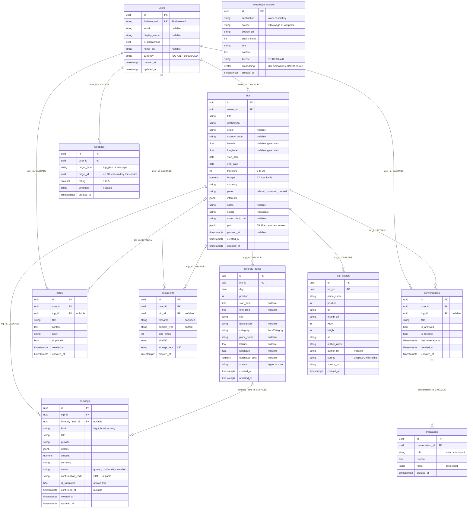
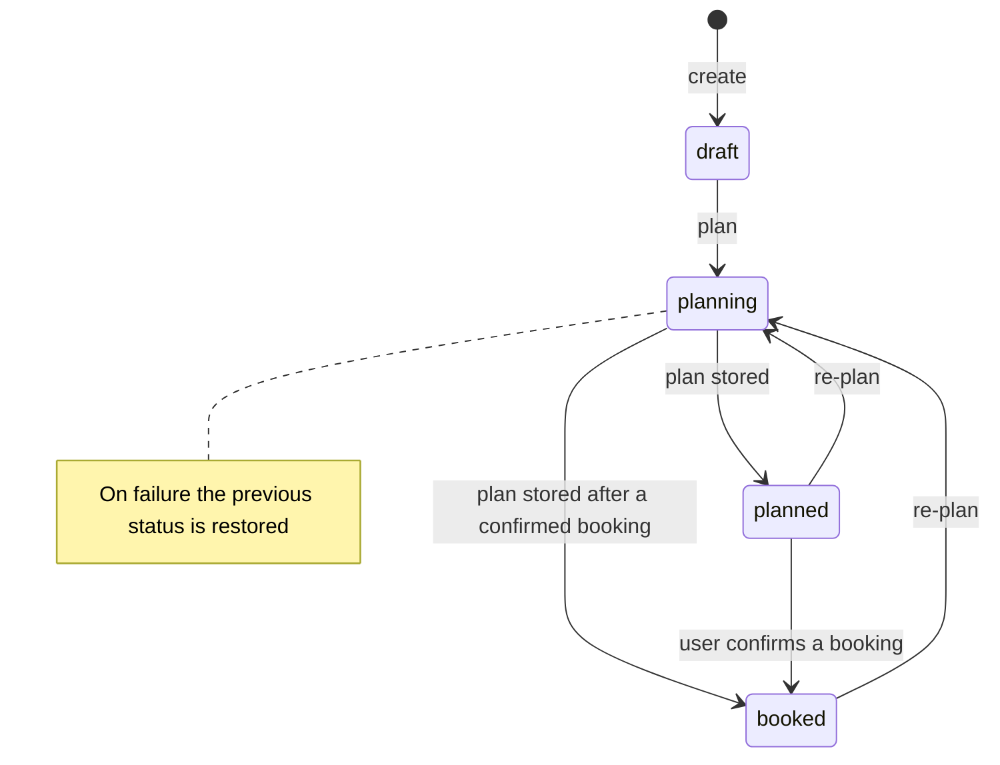
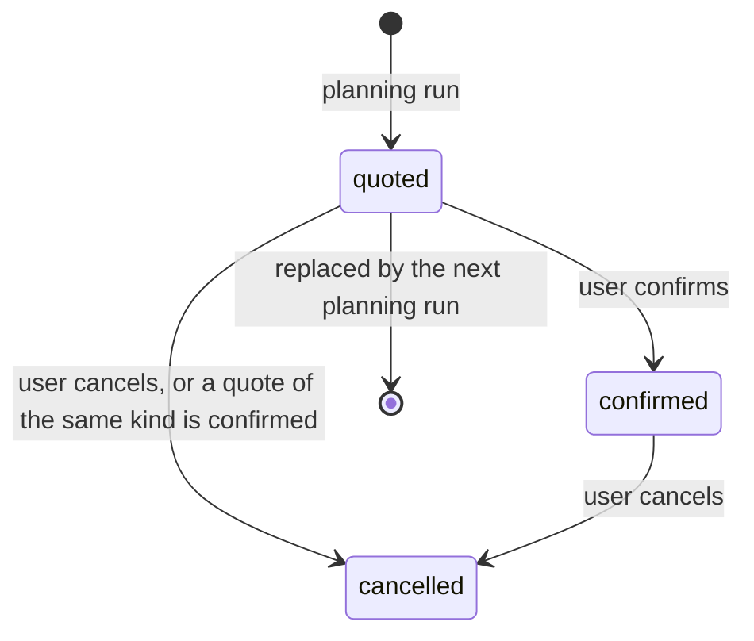

# Data model

Eleven tables, defined as SQLModel classes in `backend/app/models/` (`user.py`, `trip.py`,
`content.py`). Every row has a UUID4 primary key generated by the application and timezone-aware UTC
timestamps; `updated_at` is refreshed on every update.

## Ownership and deletion

Every user-owned table reaches `users` through a foreign key, and the repositories scope every query
by it (`owner_id`, `user_id`, or `trip_id` / `conversation_id` of a parent that was already loaded
through the user's repository). See [Security](../security.md).

| Deleting | Also deletes | Keeps, with the link set to NULL |
|---|---|---|
| A user (`DELETE /me`) | Trips and everything below them, conversations and messages, notes, documents, feedback; the stored files and the Firebase account (done by the service) | — |
| A trip | Itinerary items, bookings, photos, trip documents (the service deletes their files first) | Conversations and notes linked to it |
| An itinerary item | — | Bookings linked to it |
| A conversation | Messages; the service also deletes its ADK session | — |

`feedback.target_id` points at a trip (for `trip_plan`) or a message; it has no foreign key because the
target type varies, so `submit_feedback` checks that the caller owns the target. There is one feedback
row per user and target (unique `user_id, target_type, target_id`); a second rating updates it.

`knowledge_chunks` is shared, public reference data (guide text), not user data, and has no owner.

## Indexes and constraints

- Every foreign key column is indexed.
- Unique: `users.firebase_uid`, `documents.storage_key`, `feedback (user_id, target_type, target_id)`,
  `knowledge_chunks (source_url, chunk_index)`.
- `knowledge_chunks.destination` is indexed; `knowledge_chunks.embedding` has an HNSW index with
  `vector_cosine_ops` (`ix_knowledge_chunks_embedding_hnsw`).
- Enumerations are stored as `VARCHAR(16)` and validated by the application, so adding a value needs no
  database migration.

| Enumeration | Values |
|---|---|
| `TripStatus` | `draft`, `planning`, `planned`, `booked`, `completed`, `cancelled` |
| `TripPace` | `relaxed`, `balanced`, `packed` |
| `ItemCategory` | `sight`, `food`, `activity`, `transport`, `lodging`, `other` |
| `BookingKind` | `flight`, `hotel`, `activity` |
| `BookingStatus` | `quoted`, `confirmed`, `cancelled` |
| `MessageRole` | `user`, `assistant` |
| `FeedbackTarget` | `trip_plan`, `message` |

## Lifecycles

Trip status, driven by planning and bookings (`services/planning.py`, `services/trips.py`):

`completed` and `cancelled` are set by the traveler through `PATCH /trips/{trip_id}`.

Booking status (`TripService.confirm_booking` and `cancel_booking`):

Confirming sets a `SIM-XXXXXX` confirmation code and `confirmed_at`; confirming anything that is not
`quoted` returns `409 Conflict`.

## Schema management

- **Alembic** (`backend/alembic/`) autogenerates migrations from `SQLModel.metadata`
  (`make revision m="..."`, with type comparison) and applies them with `alembic upgrade head`:
  the Compose `migrate` service locally, the `travya-migrate` Cloud Run job in production, before the
  new API revision starts.
- **pgvector** must be installed in the database (`CREATE EXTENSION vector`). The Compose init script
  `infra/postgres/init/10-databases.sql` does this for `travya` and `travya_test`.
- **Tests** build the schema straight from the models (`create_all`) in `travya_test`.
- **ADK's tables live in a separate `adk` schema.** At startup the API runs
  `CREATE SCHEMA IF NOT EXISTS adk` and gives ADK's `DatabaseSessionService` an engine with
  `schema_translate_map={None: "adk"}`. ADK creates and owns its session, event and state tables
  there; Alembic does not manage them, and they never mix with the application tables.
