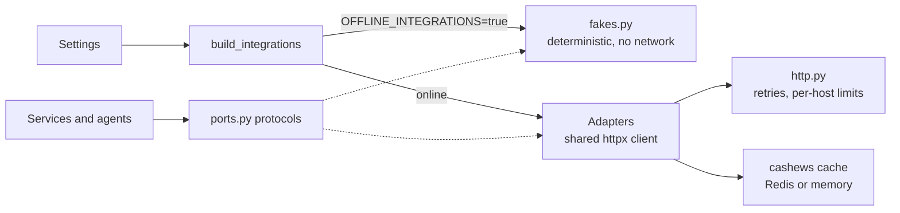

# Integrations

Services and agents depend only on the protocols in `backend/app/integrations/ports.py`. At startup
`build_integrations()` (`registry.py`) wires each port to an adapter from the settings: real services
online, deterministic fakes with `OFFLINE_INTEGRATIONS=true`. The decision is recorded in
[ADR 0007](../decisions/0007-ports-and-adapters.md).

## Ports

| Port | Used by | Real adapter | Fallback | Fake |
|---|---|---|---|---|
| `Geocoder` | Trip creation (coordinates, country), assistant tools, itinerary place lookup | `NominatimGeocoder` (nominatim.openstreetmap.org) | none | `FakeGeocoder` |
| `Autocomplete` | `GET /explore/places` | `PhotonAutocomplete` (photon.komoot.io) | none | `FakeAutocomplete` |
| `PlacesSearch` | Places scout, `search_places` tool | `OverpassPlaces` (overpass-api.de) | none | `FakePlaces` |
| `Router` | Per-day routes on the trip map | `OrsRouter` (OpenRouteService) when `ORS_API_KEY` is set | `OsrmRouter` (FOSSGIS OSRM, routing.openstreetmap.de), also the default without a key | `FakeRouter` |
| `WeatherProvider` | Weather scout, trip weather, `weather_forecast` tool | `OpenMeteoWeather` (forecast and archive APIs) | none | `FakeWeather` |
| `GuideProvider` | Guide scout and knowledge base, `GET /explore/guide`, `destination_guide` tool | `WikivoyageGuides` (en.wikivoyage.org) | Wikipedia page summary, inside the same adapter | `FakeGuides` |
| `PhotoProvider` | Trip cover photo, `POST /trips/{trip_id}/photos/refresh` | `UnsplashPhotos` when `UNSPLASH_ACCESS_KEY` is set | `WikimediaPhotos` (Wikimedia Commons), also the default without a key | `FakePhotos` |
| `OffersProvider` | Offers scout | `SampleOffers`: deterministic sample flights and hotels | none | `SampleOffers` (same) |
| `ObjectStorage` | Trip documents | `GcsStorage` with `STORAGE_BACKEND=gcs` | `LocalStorage` (default) | `MemoryStorage` |

The fallbacks are composed adapters: `FallbackRouter` switches to OSRM when OpenRouteService raises
`UpstreamUnavailable`; `FallbackPhotos` uses Wikimedia Commons when Unsplash fails or returns nothing.

Adapter results are Pydantic models (`Place`, `Route`, `DailyWeather`, `DestinationGuide`, `Photo`,
`TravelOffer`), so nothing from a third-party response reaches a service unvalidated.

Notes per adapter:

- **Open-Meteo**: inside the 16-day forecast window (with a two-day margin for time zones) the
  forecast API is used; beyond it, the archive API returns the same calendar dates from the most
  recent year with data (the archive trails real time by about a week), and each day is flagged
  `is_climate_estimate`.
- **Overpass**: one query per call for all requested categories (`tourism`, `amenity`, `leisure` and
  `shop` tags with a `name`), notable places (with `wikidata`) output first, radius capped at 25 km,
  query timeout 25 s.
- **Wikivoyage**: plain-text extract, intro plus the Understand, Get around, See, Do, Eat, Drink,
  Sleep, Stay safe and Respect sections, disambiguation pages rejected.
- **Routing**: at most 25 waypoints per route; unroutable points return no route, and the map still
  shows the stops.
- **GCS**: downloads are V4 signed URLs valid for 10 minutes, signed through the IAM `signBlob` API
  with the runtime service account, so no key file is needed. With credentials that cannot sign, and
  with local storage, the API streams the file itself. Storage keys are validated against path
  traversal.

## Caching

Adapters cache with [cashews](https://github.com/Krukov/cashews) decorators. The backend is Redis
when `REDIS_URL` is set (Upstash in production) and process memory otherwise. Only non-empty results
are stored, and coordinates are rounded before they become cache keys (weather to 2 decimals, places to
4) so nearby requests share entries.

| Data | TTL | Constant |
|---|---|---|
| Geocoding (search and reverse) | 30 days | `GEOCODE_TTL` |
| Autocomplete | 1 day | `AUTOCOMPLETE_TTL` |
| Places | 7 days | `PLACES_TTL` |
| Routes | 7 days | `ROUTE_TTL` |
| Weather forecast | 3 hours | `FORECAST_TTL` |
| Climate estimate | 30 days | `CLIMATE_TTL` |
| Guides | 30 days | `GUIDE_TTL` |
| Photo searches | 7 days | `PHOTOS_TTL` |

Guide text is additionally embedded and stored in `knowledge_chunks`, once per destination.

## Politeness and resilience

All adapters share one `httpx.AsyncClient` created in the app lifespan (`http.py`):

- **Identification**: `User-Agent: Travya/1.0 (+<repository URL>)` by default; OpenStreetMap
  services require an identifying agent, so deployments should keep a contact in `HTTP_USER_AGENT`.
- **Per-host rate limits**: Nominatim is limited to 1 request per second per process
  (`HOST_RATE_LIMITS`), as its usage policy requires. Autocomplete goes to Photon, never to Nominatim.
- **Timeouts**: `HTTP_TIMEOUT_SECONDS` (15 s) by default, 35 s for Overpass.
- **Retries**: up to 3 attempts on connection and read errors and on 429, 502, 503 and 504, with
  exponential backoff and jitter (0.5 s initial, 8 s maximum) or the server's `Retry-After`, capped at
  10 s. Every retry and every give-up is logged (`upstream_retry`, `upstream_gave_up`).
- **Failure mapping**: a host that stays unreachable or keeps failing raises `UpstreamUnavailable`,
  which becomes `503` problem+json at the API, a skipped scout in the planning pipeline, or a fallback
  adapter where one exists.
- **Bounded work per request**: places per scout (45), geocoding lookups per planning run (12), photo
  queries per refresh (7), waypoints per route (25).

## Attribution

| Source | Licence or terms | Requirement | Where Travya meets it |
|---|---|---|---|
| OpenStreetMap data (Nominatim, Photon, Overpass, OSRM, OpenRouteService, OpenFreeMap tiles) | ODbL 1.0 | Credit "© OpenStreetMap contributors" wherever the data is shown | `TripMap.attribution`, the map's attribution control, the plan's `sources` list |
| Wikivoyage, Wikipedia | CC BY-SA 4.0 | Credit and link the source page, name the licence | `GuideRead.url` and `license`; `knowledge_chunks.source_url` and `license`; the plan's `sources` |
| Open-Meteo | CC BY 4.0 | Credit Open-Meteo | The plan's `sources` ("Open-Meteo weather data") |
| Unsplash | Unsplash License and API guidelines | Hotlink the image URLs, credit the photographer and Unsplash with referral links | `Photo.author_name`, `author_url` and `source_url` carry `utm_source=travya&utm_medium=referral` |
| Wikimedia Commons | Per file (CC BY, CC BY-SA, public domain, ...) | Credit the author and link the file page | `Photo.author_name`, `author_url`, `source_url` |
| Sample offers | — | Must not look like real fares | `is_sample` on every offer, a note in `details`, `is_simulated` on every booking |

The full list of credits is on the [Credits](../credits.md) page.
