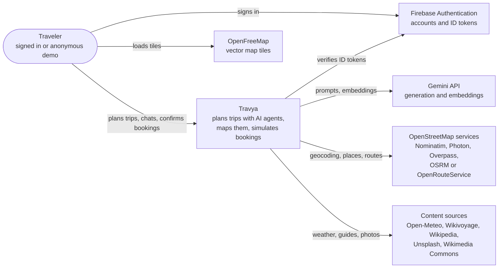
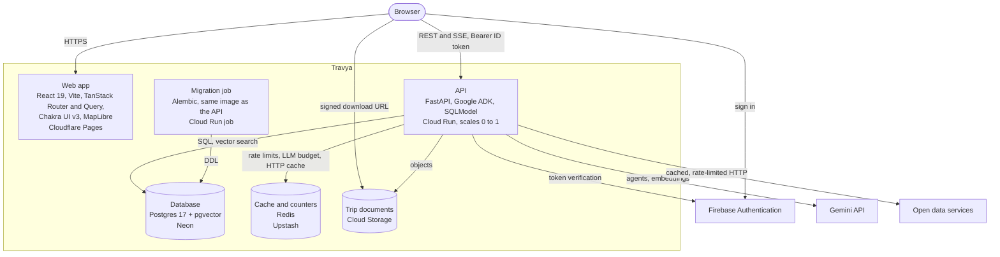
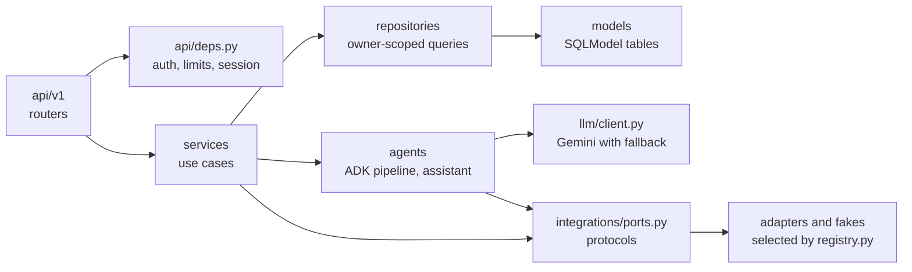
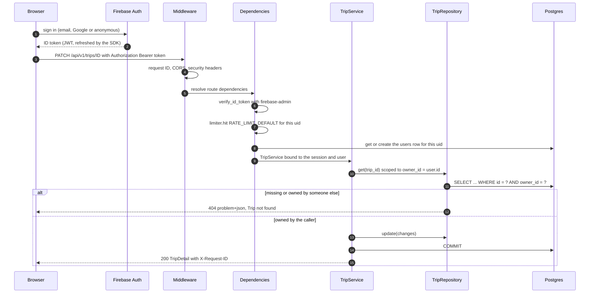

# Architecture overview

Travya is a single-page web app in front of one FastAPI service. The API owns all data access, all
model calls and all calls to third-party services; the browser talks only to the API, to Firebase
Authentication and to the map tile server.

## System context (C4 level 1)

## Containers (C4 level 2)

Locally the same containers run in Docker Compose: `pgvector/pgvector:pg17` for Neon,
`redis:8-alpine` for Upstash, the Firebase Auth emulator, local disk for Cloud Storage and nginx
(`frontend/nginx.conf`) or the Vite dev server for Cloudflare Pages.

## Inside the API

| Package | Responsibility |
|---|---|
| `app/main.py` | App factory, lifespan (logging, Sentry, Firebase, cache, HTTP client, integrations, limiter, ADK session service), CORS, request IDs, security headers |
| `app/core/` | Settings, async engine, domain errors and problem+json handlers, structured logging, rate limiter, Firebase token verification |
| `app/api/v1/` | Thin routers: validate input, call one service, map to response schemas |
| `app/services/` | Use cases: trips, planning, chat, documents, notes, feedback, knowledge base, users |
| `app/repositories/` | `ScopedRepository` and one subclass per table; every query carries the owner scope |
| `app/agents/` | The ADK planning pipeline, its prompts, scouts and checks; the travel assistant; SSE event model |
| `app/llm/` | Gemini model with retries and fallback, safety settings, embeddings |
| `app/integrations/` | Ports, adapters for each provider, fakes, the shared HTTP client, cache TTLs, the registry |
| `app/models/`, `app/schemas/` | Tables, and the request, response and structured-output models |

Routers never build error responses and never touch the database directly. Services raise domain
errors (`NotFound`, `Conflict`, `RateLimited`, ...) that `core/errors.py` turns into
`application/problem+json`.

## Request lifecycle

An authenticated request, for example `PATCH /api/v1/trips/{trip_id}`:

1. **Identity.** The SPA signs in with the Firebase SDK and sends the ID token as a bearer token.
   `get_principal` verifies it (signature, audience, expiry, 10 s clock skew) and builds a
   `Principal` (uid, email, anonymous flag, `admin` custom claim).
2. **Rate limit.** `get_current_user` spends one unit of the caller's `RATE_LIMIT_DEFAULT` window,
   then loads or creates the local `users` row. An anonymous demo account that is later upgraded keeps
   its uid, so the row and all its data carry over.
3. **Route limits.** Expensive routes add their own limit (`rate_limit("6/hour", "plan")`) and the
   planning and chat services spend one unit of the global daily LLM budget before the stream opens.
4. **Service and repository.** The service builds repositories bound to the user (or to a trip that
   was loaded through the user's repository). A foreign id and a missing id both raise `NotFound`.
5. **Response.** Errors become problem+json; every response carries `X-Request-ID`, which also tags
   every log line for that request.

Unauthenticated routes are limited to `/api/v1/health/*` and the OpenAPI documents.

## Streaming

Planning and chat answer with `text/event-stream` (sse-starlette). Validation, ownership checks, rate
limits and the budget run before the stream opens, so those failures are plain HTTP errors; once the
stream is open, failures arrive as `error` events. The event format is in [the API reference](../api.md#server-sent-events)
and the event sequence in [Agents](agents.md#one-planning-run).
