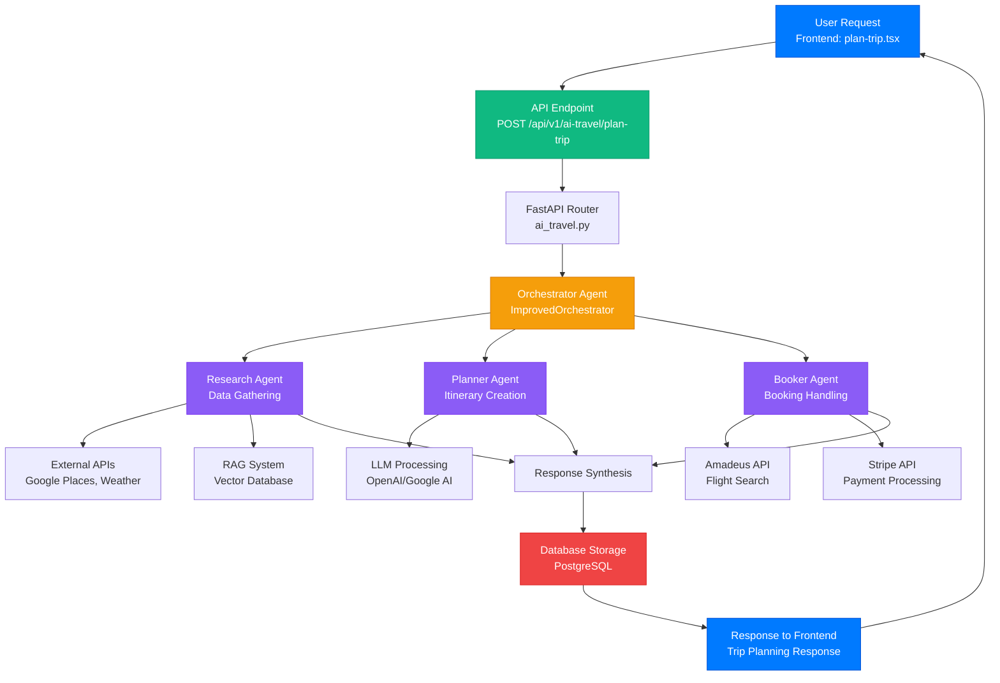
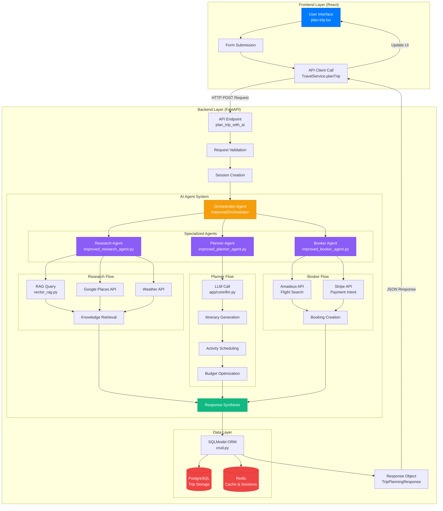
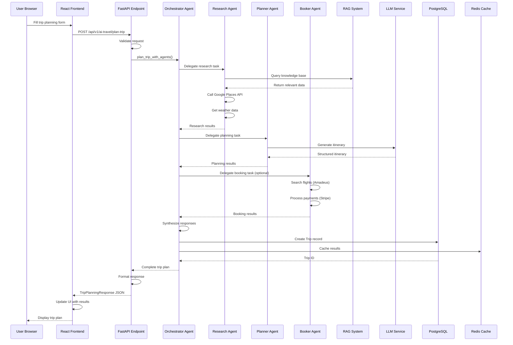
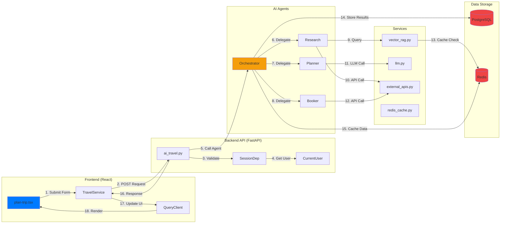

# Request Processing Flow - Mermaid Diagram

## Basic Flow Diagram



## Detailed Flow with Components



## Sequence Diagram



## Component Interaction Diagram



## Simplified Production Flow

```mermaid
flowchart TD
    Start([User Clicks 'Plan Trip']:::user) --> Validate{Validate Form Data}
    Validate -->|Valid| Send[Send POST Request]:::api
    Validate -->|Invalid| Error[Show Error]:::error
    Error --> Start
    
    Send --> Receive[API Receives Request]:::api
    Receive --> Auth{Authenticate User}
    Auth -->|Unauthorized| Redirect[Redirect to Login]:::error
    Auth -->|Authorized| Orchestrate[Call Orchestrator]:::agent
    
    Orchestrate --> Parallel{Parallel Execution}
    
    Parallel --> Research[Research Agent]:::agent
    Parallel --> Plan[Planner Agent]:::agent
    Parallel --> Book[Booker Agent]:::agent
    
    Research --> RAG[Query RAG System]:::service
    Research --> API1[Call External APIs]:::service
    RAG --> Combine1[Combine Research Data]:::process
    API1 --> Combine1
    
    Plan --> LLM[Call LLM]:::service
    LLM --> Generate[Generate Itinerary]:::process
    
    Book --> Flight[Search Flights]:::service
    Book --> Payment[Process Payment]:::service
    
    Combine1 --> Synthesize[Synthesize Response]:::process
    Generate --> Synthesize
    Flight --> Synthesize
    Payment --> Synthesize
    
    Synthesize --> Save[Save to Database]:::database
    Save --> Cache[Update Cache]:::database
    Cache --> Response[Return Response]:::api
    
    Response --> Display[Display Results]:::frontend
    Display --> End([Trip Created Successfully]:::success)
    
    classDef user fill:#007aff,stroke:#0051d5,color:#fff
    classDef api fill:#10b981,stroke:#059669,color:#fff
    classDef agent fill:#f59e0b,stroke:#d97706,color:#fff
    classDef service fill:#8b5cf6,stroke:#7c3aed,color:#fff
    classDef process fill:#06b6d4,stroke:#0891b2,color:#fff
    classDef database fill:#ef4444,stroke:#dc2626,color:#fff
    classDef error fill:#f87171,stroke:#ef4444,color:#fff
    classDef success fill:#10b981,stroke:#059669,color:#fff
    classDef frontend fill:#007aff,stroke:#0051d5,color:#fff
```

## Usage in Documentation

Copy any of these Mermaid diagrams into your:
- README.md
- Presentation slides (if supported)
- Documentation files
- Project reports

Most markdown viewers (GitHub, GitLab, VS Code with extension) render Mermaid diagrams automatically.

