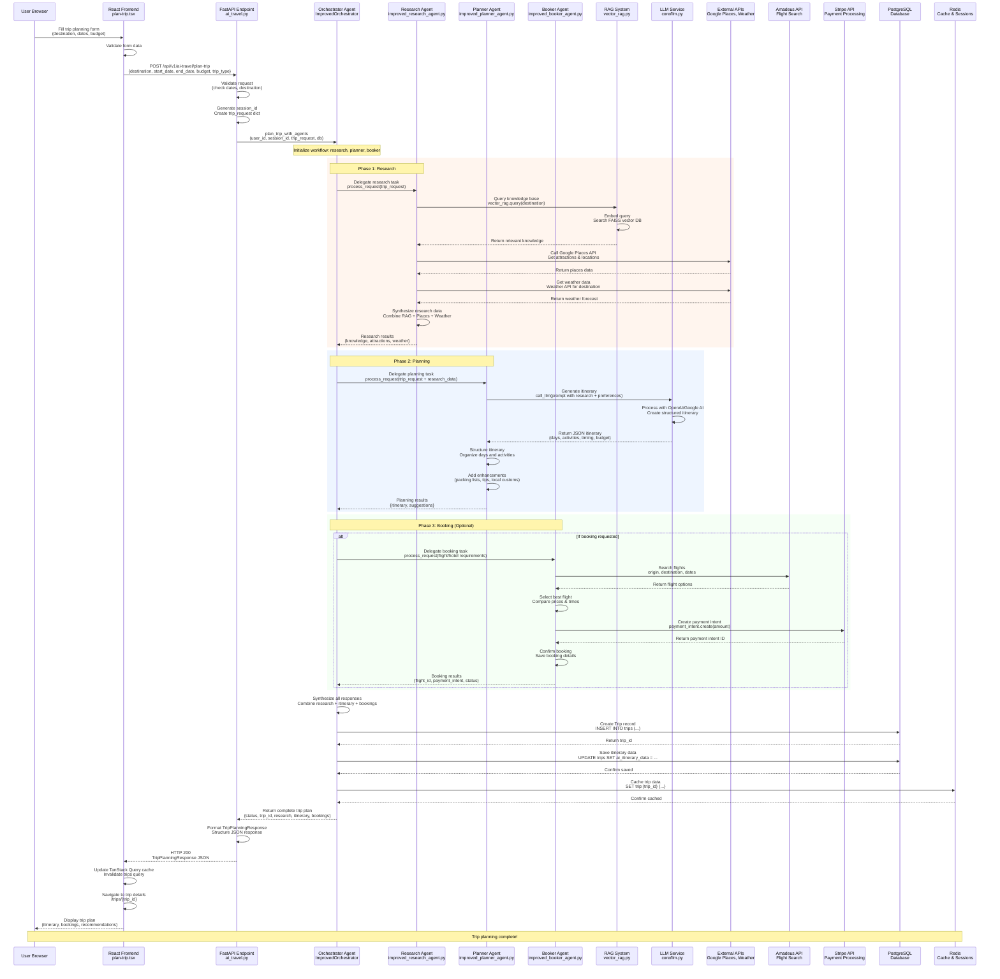
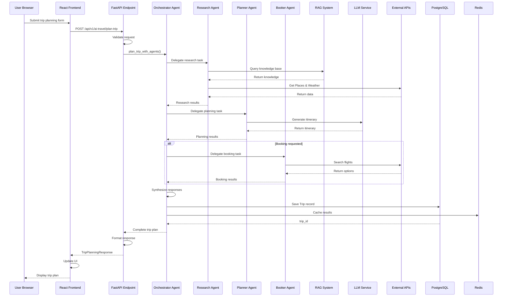

# Standalone Mermaid Sequence Diagrams

Copy each diagram individually to Mermaid Live Editor.

## 1. Complete Trip Planning Flow (Copy this to Mermaid Live Editor)

## 2. Simplified Trip Planning Flow (Alternative - Easier to render)

