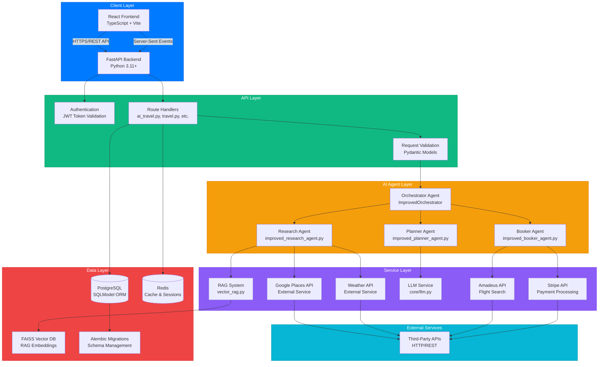
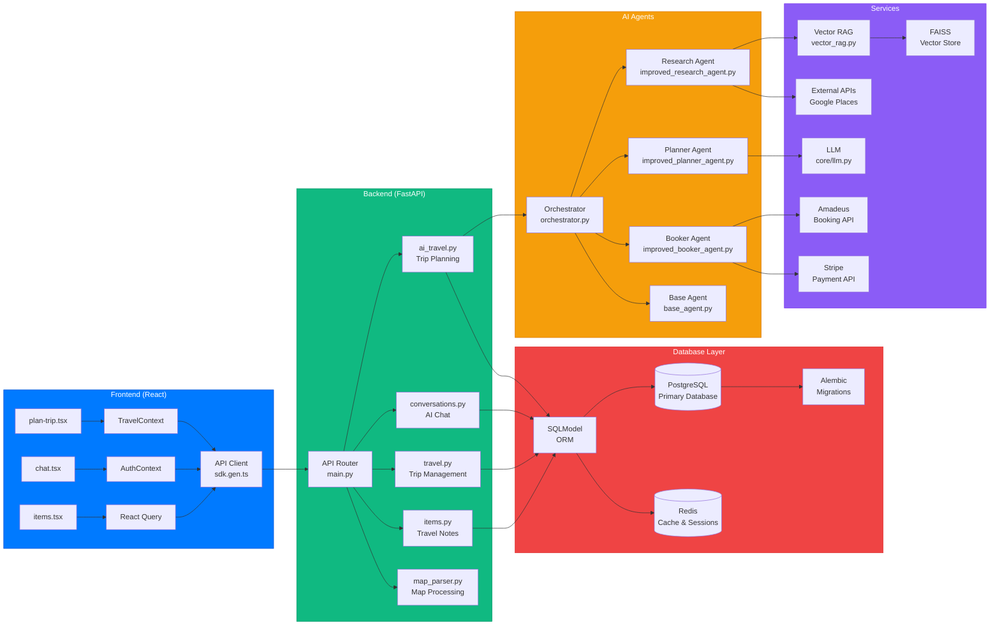
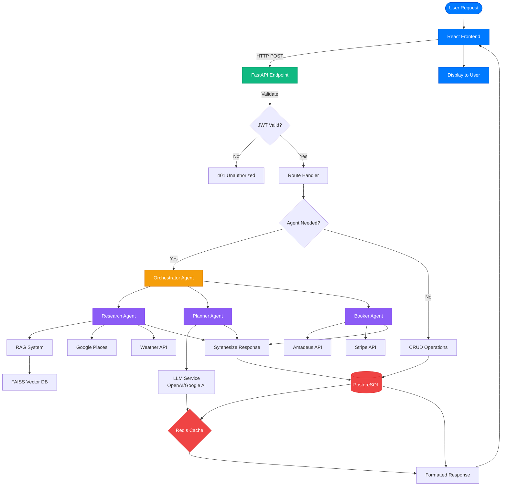

# System Design - Travya Architecture

## High-Level Architecture Overview

Travya follows a **layered architecture** with clear separation between frontend, backend, AI agents, and data layers.

## Complete System Architecture



## Detailed Component Architecture



## Data Flow Architecture



## Technology Stack

### Frontend Layer
```
React 18.2+
├── TypeScript 5.0+
├── TanStack Router (File-based routing)
├── TanStack Query (Data fetching & caching)
├── Chakra UI (Component library)
├── Vite (Build tool)
└── React Hooks (State management)
```

### Backend Layer
```
FastAPI 0.109+
├── Python 3.11+
├── SQLModel (ORM)
├── Pydantic (Validation)
├── Alembic (Migrations)
├── Uvicorn (ASGI server)
└── Python-Jose (JWT)
```

### AI Agent System
```
Multi-Agent Architecture
├── Base Agent (Abstract base class)
├── Orchestrator Agent (Coordination)
├── Research Agent (Information gathering)
├── Planner Agent (Itinerary generation)
└── Booker Agent (Booking operations)
```

### Service Layer
```
Business Logic Services
├── Vector RAG Service (FAISS + Embeddings)
├── LLM Service (OpenAI/Google AI integration)
├── Redis Cache Service (Caching layer)
├── External API Clients (Google Places, Amadeus, Stripe)
└── Document Storage Service
```

### Data Layer
```
Storage & Caching
├── PostgreSQL (Primary database)
│   ├── SQLModel tables (Users, Trips, Items, Conversations)
│   └── Alembic migrations
├── Redis (Cache & Sessions)
│   ├── Session storage
│   ├── Query caching
│   └── Agent state
└── FAISS (Vector database for RAG)
    └── Semantic search
```

## Component Responsibilities

### Frontend Components

**Routes (`frontend/src/routes/`)**
- `_layout/index.tsx` - Dashboard with trip overview
- `_layout/plan-trip.tsx` - Trip planning interface
- `_layout/chat.tsx` - AI chat interface
- `_layout/items.tsx` - Travel Notes management
- `_layout/trips.tsx` - Trip list and details
- `_layout/settings.tsx` - User settings

**Components (`frontend/src/components/`)**
- `Common/` - Navbar, Sidebar, shared UI
- `Items/` - Travel Notes CRUD components
- `MapParserComponent.tsx` - Map visualization
- `PhotoGallery.tsx` - Photo display
- `ItineraryDisplay.tsx` - Itinerary rendering

**Contexts (`frontend/src/contexts/`)**
- `AuthContext.tsx` - Authentication state
- `TravelContext.tsx` - Travel data management
- `SidebarContext.tsx` - UI state

### Backend Components

**API Routes (`backend/app/api/routes/`)**
- `ai_travel.py` - AI-powered trip planning
- `travel.py` - Standard trip CRUD
- `conversations.py` - AI chat endpoints
- `items.py` - Travel Notes endpoints
- `map_parser.py` - Map parsing
- `photo_gallery.py` - Photo management

**Agents (`backend/app/agents/`)**
- `orchestrator.py` - Agent coordination
- `improved_research_agent.py` - Information research
- `improved_planner_agent.py` - Itinerary planning
- `improved_booker_agent.py` - Booking operations
- `base_agent.py` - Base agent class

**Services (`backend/app/services/`)**
- `vector_rag.py` - RAG implementation with FAISS
- `redis_cache.py` - Caching utilities
- `llm.py` - LLM service wrapper (in core/)
- External API clients

**Models (`backend/app/models.py`)**
- User, Trip, Itinerary, Booking
- Conversation, ConversationMessage
- Item (Travel Notes)
- SQLModel definitions

## Communication Patterns

### Synchronous Communication
- **Frontend ↔ Backend**: REST API (HTTPS)
- **Backend ↔ Database**: SQL queries via SQLModel
- **Agents ↔ Services**: Direct function calls
- **Services ↔ External APIs**: HTTP requests

### Asynchronous Communication
- **Real-time Updates**: Server-Sent Events (SSE)
- **Agent Events**: Redis pub/sub
- **Background Tasks**: Async/await in Python

### Caching Strategy
```
Request Flow with Caching:
1. Check Redis cache
2. If cache miss → Query database
3. Store result in Redis (TTL: 1 hour)
4. Return response
```

## Security Architecture

```
Security Layers:
├── JWT Authentication
│   ├── Token generation on login
│   ├── Token validation on requests
│   └── Token refresh mechanism
├── Password Hashing
│   └── bcrypt with salt
├── CORS Configuration
│   └── Whitelisted origins
└── Input Validation
    └── Pydantic models
```

## Deployment Architecture

```
Production Deployment:
├── Docker Compose
│   ├── Frontend (Nginx)
│   ├── Backend (FastAPI)
│   ├── PostgreSQL
│   └── Redis
├── Environment Configuration
│   ├── .env files
│   └── Secrets management
└── Reverse Proxy
    └── Nginx/Traefik
```

## Scalability Considerations

### Horizontal Scaling
- **Frontend**: Stateless, can scale horizontally
- **Backend**: Stateless API, load balancer ready
- **Database**: PostgreSQL with read replicas
- **Cache**: Redis cluster support

### Performance Optimization
- **Caching**: Redis for frequent queries
- **Database Indexing**: Optimized queries
- **Agent Parallelization**: Concurrent agent execution
- **CDN**: Static asset delivery

## Monitoring & Observability

```
Monitoring Stack:
├── Logging (Python logging)
├── Error Tracking (Exception handlers)
├── Health Checks (/api/v1/health)
└── Performance Metrics
    ├── Request/response times
    ├── Database query times
    └── Agent execution times
```
